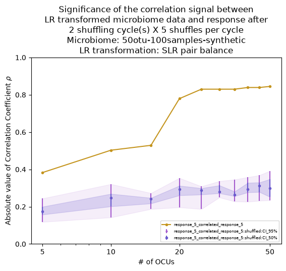
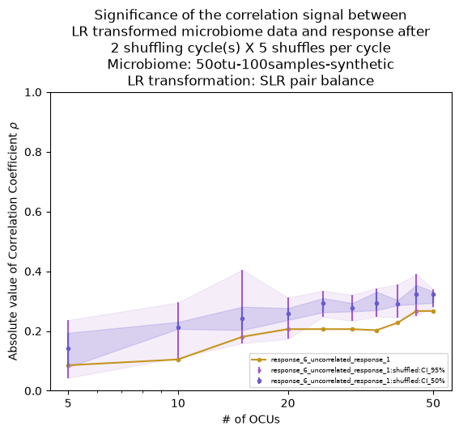

# CompoRes Package


`CompoRes` package is an algorithmic package designed to analyze the connection between changes in the host’s microbiota
and the host’s response (e.g., gene expression, changes in the microenvironmental parameters). It addresses two
significant analysis challenges: compositional statistics in the microbiota and multiple hypothesis testing that
results in false correlations between microbiota and host.

## Contents

1. [Quick Start Guide](#quick-start-guide)
    - [Installation](#installation)
    - [Configuration File Usage](#configuration-file-usage)
    - [Run](#run)
    - [Test Runs](#test-runs)
    - [Output overview](#output-overview)
2. [Computational Requirements](#computational-requirements)
3. [Runtime Tips](#runtime-tips)
4. [Package Structure](#package-structure)
   - [Preprocessing](#preprocessing)
   - [Computational Module Overview](#computational-module-overview)
5. [Configuration File Structure and Naming Conventions](#configuration-file-structure-and-naming-conventions)
6. [Input Files](#input-files-formatting)
   - [Microbiome Files](#microbiome-file-appearance)
   - [Response Files](#response-file-appearance)
   - [Metadata Files](#metadata-file-appearance)
7. [Advanced Features](#advanced-features)
    - [OTU Analysis](#otu-wise-cumulative-p-value-tracing-and-analysis)
    - [Classification Analysis](#binary-classification-power-analysis-process)
    - [Logging](#logging)


## QUICK START GUIDE

### INSTALLATION

`CompoRes` runs on Linux (glibc 2.28 or newer, e.g., RHEL/Rocky 8+ or Ubuntu 20.04+) and macOS (Intel and Apple
Silicon). No administrator (root) rights are needed: everything is installed into a conda environment in your home
directory.

1. Clone the repository (if you plan to contribute, fork it first and clone your fork):

```bash
git clone https://github.com/AmirErez/CompoRes.git
cd CompoRes
```

2. Create the environment, with the tested versions of all dependencies, using `conda` or `mamba` (`mamba` is usually
   much faster):

```bash
conda env create --file env/compores_env.yml
# or
mamba env create --file env/compores_env.yml
```

3. Activate the environment:

```bash
conda activate compores_env
# or
mamba activate compores_env
```

4. Install `CompoRes` into the environment, which adds the `compores` command:

```bash
pip install -e .
```

`-e` (editable) links the environment to this folder instead of copying the code, so code changes, e.g., after a
`git pull`, take effect without reinstalling. The `compores` command is available whenever the environment is active.

If you created `compores_env` with an earlier version of `env/compores_env.yml`, remove it first
(`conda env remove -n compores_env`) and create it again, to get the tested versions.

#### Uninstalling

```bash
pip uninstall compores              # removes the compores command; the environment stays
conda env remove -n compores_env    # removes the environment and everything installed in it
```

Then delete the `CompoRes` folder.

[Back to Contents](#contents)

### CONFIGURATION FILE USAGE
The configuration file path is given with the `--config` argument when running the `CompoRes` package (see
[Run](#run)).

1. Create a configuration file: start from the example `configs/config.yaml` in the repository, where every setting
   is explained by a comment.
2. Update the experiment parameters (`GROUP1`, `GROUP2`, `GROUP3`); they also name the input files (see
   [Naming Conventions](#naming-conventions)).
3. Change the paths to the input data directories as desired; relative paths are read relative to the folder of the
   configuration file. `CompoRes` reads the following files from them:
    1. microbiome: `{PATH_TO_MICROBIOME}/{GROUP1}-{GROUP2}-{GROUP3}.tsv`
    2. response: `{PATH_TO_RESPONSE}/{GROUP1}-{GROUP2}.tsv`
    3. metadata (optional): `{PATH_TO_METADATA}/{GROUP1}-{GROUP2}-metadata.tsv`; if there is no metadata, set
       `PATH_TO_METADATA` to an empty string
4. Optional: change other parameters as desired.

NOTE: If no configuration file is given, the package runs the [full test](#full-test) on the bundled synthetic data.

[Back to Contents](#contents)

### RUN

To try `CompoRes` on the bundled synthetic data first, see [Test Runs](#test-runs) below.

To run the package on your data, activate the environment and run, from any folder:

```bash
compores --config {path_to_config_file}
```

To run only the preprocessing step, the OTU clustering included, on your data:

```bash
compores --config {path_to_config_file} --preprocess
```

The preprocessing results are stored in the `preprocessing_results` folder of the output directory.

Without step 4 of the installation, the same commands run from the `src` folder as `python -m compores` instead of
`compores`, e.g.:

```bash
cd src

python -m compores --config {path_to_config_file}
```

Configuration files written for earlier versions of `CompoRes`, with paths relative to the folder it was run from,
still work when run from that folder: `CompoRes` detects them and logs a warning.

[Back to Contents](#contents)

### TEST RUNS

Two test runs on bundled synthetic data check that the installation works and show what `CompoRes` produces. Start
with the quick test; run the full test when you want the complete picture.

Run the tests from the `CompoRes` folder, with the environment active.

#### Quick test

```bash
compores --config configs/config_synthetic_data_quick.yaml
```

#### Full test

```bash
compores
```

The full test uses the default configuration file, `configs/config_synthetic_data.yaml`. The two tests run the same
analysis on the same data and differ only in how many OCU levels and shuffles they process:

|                                      | Quick test                                  | Full test                                      |
|--------------------------------------|---------------------------------------------|------------------------------------------------|
| Configuration file                   | `configs/config_synthetic_data_quick.yaml`  | `configs/config_synthetic_data.yaml` (default) |
| OCU levels processed                 | 10 (50, 45, ..., 5; `OCU_SAMPLING_RATE: 5`) | 48 (50, 49, ..., 3; `OCU_SAMPLING_RATE: 1`)    |
| Shuffles per OCU level               | 10 (`N_SHUFFLES: 5` x `SHUFFLE_CYCLES: 2`)  | 50 (`N_SHUFFLES: 10` x `SHUFFLE_CYCLES: 5`)    |
| Run time (18-core Apple Silicon Mac) | about 75 seconds                            | about 13 minutes                               |
| Output folder                        | `artificial_experiment_output_quick`        | `artificial_experiment_output`                 |

The quick test also runs, with its results checked, as part of the automated test suite (`tests/test_quick_test_run.py`),
so every push to the repository is tested end to end. To run the test suite yourself, run `pytest` from the `CompoRes`
folder; the optional, much slower test of the power analysis runs only with `pytest -m slow`.

Note: `CompoRes` saves its progress and resumes from it, so running a test again with its output folder in place only
re-reports the stored results. Delete the output folder to rerun a test from scratch. The shuffles are random, so the
numbers you get will differ slightly from the examples below.

#### What the test does

The synthetic data lives in `tests/data/artificial_experiment_data`:

- Microbiome, `microbiome/50otu-100samples-synthetic.tsv`: relative abundances of 50 OTUs in 100 samples.
- Responses, `response/50otu-100samples.tsv`: 10 responses for the same 100 samples. Five of them were generated from
  a known log-ratio balance of the microbiome; the other five are random noise that does not depend on the microbiome:

| Responses                                               | Numerator OTUs       | Denominator OTUs       | Target correlation |
|---------------------------------------------------------|----------------------|------------------------|--------------------|
| `correlated_response_1` ... `correlated_response_5`     | OTU_2, OTU_5, OTU_24 | OTU_11, OTU_13, OTU_35 | 0.86 - 0.92        |
| `uncorrelated_response_1` ... `uncorrelated_response_5` | none (noise)         | none (noise)           | 0                  |

##### From OTUs to OCUs

Many OTUs rise and fall together across samples, and a response may be linked to such a group rather than to a single
OTU. `CompoRes` therefore groups correlated OTUs into OCUs: an OCU is a cluster of OTUs whose abundance in each sample
is the sum of its OTUs' abundances. Rather than committing to one grouping, `CompoRes` repeats the whole analysis at
many levels of grouping, from one OTU per OCU down to a few large OCUs. A response truly linked to the microbiome shows a
significant signal across many levels; a chance correlation does not.

The OCUs are obtained in three steps (for details, see [OTU clustering](#otu-clustering)):

1. SparCC estimates the correlation between every pair of OTUs, taking into account that the data is compositional.
2. The correlations are turned into distances, 0.5 x (1 - correlation), and the OTUs are clustered hierarchically
   (average linkage) into a tree, or dendrogram.
3. Cutting the tree at different heights gives the OCU levels: low cuts give many small OCUs, high cuts give a few
   large ones. `OCU_SAMPLING_RATE` sets how many levels are processed: every level in the full test (50, 49, ..., 3
   OCUs) and every 5th level in the quick test (50, 45, ..., 5 OCUs).

The tree below is drawn from the quick test's SparCC correlations with the same distance and linkage as `CompoRes`
(`CompoRes` itself does not draw it). The dashed line is the cut that gives 10 OCUs: every branch it crosses is one OCU.


OTU_5 and OTU_24, two of the true numerator OTUs, are the most correlated pair and join first, so they share an OCU at
every level below 50 OCUs. At 10 OCUs, for example, the true OTUs sit in these OCUs:

| OCU at the 10-OCU level | OTUs                                                                     |
|-------------------------|--------------------------------------------------------------------------|
| `ocu_3`                 | **OTU_5**, OTU_8, OTU_20, **OTU_24**, OTU_50                             |
| `ocu_6`                 | **OTU_2**, OTU_18, OTU_23                                                |
| `ocu_8`                 | **OTU_13**, OTU_28, OTU_31, OTU_32, **OTU_35**, OTU_37, OTU_45, OTU_46   |
| `ocu_5`                 | **OTU_11**, OTU_12, OTU_14, OTU_15, OTU_25, OTU_27, OTU_30, OTU_36, OTU_41, OTU_42 |

The OCU membership of every level is listed in an `..._OCU_taxa_mapping.csv` file in every
`plots/response_vs_best_balance/50otu-100samples-synthetic/{method}/{level}/` folder, and in
`preprocessing_results/microbiome/OCUs/50otu-100samples-synthetic/50otu-100samples-synthetic_ocu_clustering_dictionary.json`.
The OCU abundance matrix of every level is in the `{level}/` folders next to that file.

##### The analysis

The test runs the whole `CompoRes` pipeline on this data:

1. **Preprocessing:** checks the input files, filters rare taxa, imputes zeros (this data has none) and normalizes each
   sample to sum to one.
2. **OTU clustering:** groups the OTUs into OCUs at every processed level, as described above.
3. **Best balance search:** at every OCU level and for every response, finds the log-ratio balance with the highest
   absolute correlation to the response (Pearson correlation, as set by `CORR`). This is done twice: with `CLR` balances (one OCU against the geometric
   mean of all OCUs) and with `pairs` balances (the log-ratio of two OCUs).
4. **Significance:** shuffles the microbiome samples (as set by `SHUFFLE`) and repeats the best balance search on the shuffled data, many
   times. This gives the distribution of the best correlation expected by chance, from which p-values are estimated in
   two ways: empirically (bootstrap) and by fitting a GEV distribution.
5. **Ranking:** ranks the responses by their -ln(p) averaged over all processed OCU levels.

The test succeeds when the five correlated responses rank above all five noise responses, and the best balances are
built from the OTUs that generated them.

#### Walking through the test outputs

All outputs are written to the test's output folder; its layout is described in [Output Overview](#output-overview).
The examples below come from the quick test, with the `pairs` balance method unless noted otherwise; every output also
exists for `CLR`.

##### 1. Response ranking

The response ranking answers which responses are linked to the microbiome. It is in
`compores_response_ranking/50otu-100samples-synthetic/pairs/minus_mean_log_p_value_sorted_responses_at_shuffling_cycle_2.csv`
(one file is written per shuffling cycle; this is the last one):

| Response                              | gev   | bootstrap |
|---------------------------------------|-------|-----------|
| `response_5_correlated_response_5`    | 24.62 | 2.40      |
| `response_2_correlated_response_2`    | 21.31 | 2.40      |
| `response_3_correlated_response_3`    | 20.50 | 2.40      |
| `response_1_correlated_response_1`    | 20.24 | 2.40      |
| `response_4_correlated_response_4`    | 19.53 | 2.40      |
| `response_8_uncorrelated_response_3`  | 4.28  | 1.72      |
| `response_10_uncorrelated_response_5` | 0.50  | 0.55      |
| `response_7_uncorrelated_response_2`  | 0.17  | 0.17      |
| `response_9_uncorrelated_response_4`  | 0.09  | 0.07      |
| `response_6_uncorrelated_response_1`  | 0.09  | 0.08      |

Each value is the response's -ln(p) averaged over the processed OCU levels, where p is the p-value of the response's
best balance at that level; higher means more significant. For example, the best balance of `correlated_response_5` hit
the GEV floor of p = 1e-11 (-ln(p) = 25.33) at 9 of the 10 levels and had p = 1.2e-8 (-ln(p) = 18.23) at 35 OCUs (see
part 4 below), so its score is (9 x 25.33 + 18.23) / 10 = 24.62.

All five correlated responses rank on top, with a clear gap to the noise responses. A noise response can still score a
few units by chance, as `uncorrelated_response_3` does here, which is why the gap matters more than any single value.
The `CLR` ranking (in the `CLR` folder) agrees: the five correlated responses score between 12.4 and 21.6 and the noise
responses at most 6.5. In general, responses that rank high for both balance methods and both p-value columns are the
most reliable. With more shuffling cycles the ranking settles; responses with very small p-values may still swap places
between cycles.

The two columns show why `CompoRes` fits a GEV distribution. With 10 shuffles the smallest possible empirical p-value
is 1/11, so the bootstrap column cannot go above ln(11) = 2.40, and all correlated responses tie there (in the full test,
with 50 shuffles, the ceiling is ln(51) = 3.93). The GEV fit extrapolates the tail of the shuffled distribution and
separates them; its p-values are floored at 1e-11, so the GEV column cannot go above -ln(1e-11) = 25.3.

##### 2. Signal significance plots

`plots/compores_signal_significance/50otu-100samples-synthetic/pairs/` holds one plot per response. The orange line is
the absolute correlation of the best balance at every OCU level; in purple is the best correlation found in shuffled
data (dots: median, dark band: 25th to 75th percentile, light band and whiskers: 2.5th to 97.5th percentile).




For `correlated_response_5` (left), the real correlation is far above the shuffled bands at every OCU level. It is
strongest, about 0.84, from 25 to 50 OCUs, and drops at coarser clustering, as the true OTUs get merged with unrelated
OTUs. For `uncorrelated_response_1` (right), the real correlation stays inside or below the shuffled bands.

The shuffled bands rise with the number of OCUs: more OCUs means more candidate balances, so the best one correlates
better by chance alone. This is the multiple-testing effect that the shuffling accounts for.

The full test produces the same plot with all 48 OCU levels and 50 shuffles, which shows the step-like changes in the
signal as true OTUs split into their own OCUs:


##### 3. Response vs. best balance plots

`plots/response_vs_best_balance/50otu-100samples-synthetic/pairs/{OCU level}/` holds, for every response, a scatter
plot of the response against its best balance at that OCU level, with the fitted line. The box in the corner counts the
samples with imputed values (none in this data). Samples are colored by their group in the metadata file; the quick test
has no metadata, so all samples are "Uncategorized".


At 50 OCUs, the best balance for `correlated_response_5` (left) is `ocu_5` over `ocu_35`, with a correlation of 0.845.
At this level every OCU is a single OTU (`ocu_5` is OTU_5 and `ocu_35` is OTU_35), so the balance pairs one OTU from
each side of the true balance. The best balance for `uncorrelated_response_1` (right) reaches only 0.27, a correlation
that the shuffled data matches by chance (see the plot above).

##### 4. Best balance at every OCU level

`balance_calculation_results/50otu-100samples-synthetic/pairs/ocu_level_results/regular/` has one table per response
with the best balance at every OCU level, its correlation (`rho`), the fitted line (`slope`, `intercept`, `rmse`),
percentiles of the shuffled correlations, and both p-values. For `correlated_response_5` (OTUs from the true balance in
bold):

| OCU level | Numerator OTUs                                | Denominator OTUs                                                       | rho  | Shuffled median rho | p (GEV) |
|-----------|-----------------------------------------------|------------------------------------------------------------------------|------|---------------------|---------|
| 50        | **OTU_5**                                     | **OTU_35**                                                             | 0.84 | 0.30                | 1e-11   |
| 45        | **OTU_5**, **OTU_24**                         | **OTU_35**                                                             | 0.84 | 0.31                | 1e-11   |
| 35        | **OTU_5**, **OTU_24**                         | **OTU_13**, **OTU_35**                                                 | 0.83 | 0.26                | 1.2e-8  |
| 20        | **OTU_5**, **OTU_24**                         | **OTU_13**, OTU_32, **OTU_35**, OTU_45                                 | 0.78 | 0.29                | 1e-11   |
| 10        | **OTU_5**, OTU_8, OTU_20, **OTU_24**, OTU_50  | **OTU_13**, OTU_28, OTU_31, OTU_32, **OTU_35**, OTU_37, OTU_45, OTU_46 | 0.50 | 0.25                | 1e-11   |
| 5         | 14 OTUs, including **OTU_2** and **OTU_11**   | 8 OTUs, including **OTU_13** and **OTU_35**                            | 0.38 | 0.18                | 1e-11   |

As the clustering gets coarser, the true OTUs are merged with unrelated OTUs and the correlation drops. At 5 OCUs the
numerator even mixes OTU_2 from the true numerator with OTU_11 from the true denominator. Still, the correlation stays
well above the shuffled median at every level.

The `sample_level_results` folder next to it has, for every response and OCU level, the balance value and response value
of every sample.

##### 5. Per-taxon ranking

The response ranking says which responses are linked to the microbiome; OTU tracing says which OTUs carry the link,
response by response. It runs on demand, after the main analysis:

```bash
compores --config configs/config_synthetic_data_quick.yaml --include_otu_trace_analysis
```

If the test has already run, this only adds the tracing (about 3.5 minutes for the 10 test responses). Without
`--response`, every response is traced; add, e.g., `--response response_5` to trace one response.

For `CLR`, every OTU gets two scores per response: one for a positive and one for a negative association. At every OCU
level, the -ln(p) of each OCU's correlation with the response is split equally among the OTUs in that OCU and added to
their positive or negative score, according to the sign of the correlation. Each score is then divided by the number
of levels that added to it, which makes it an average over OCU levels. So an OTU scores high when the OCUs that contain
it correlate significantly with the response.

The scores are in
`otu_significance_tracing/50otu-100samples-synthetic/CLR/50otu-100samples-synthetic_otu_clr_minus_mean_log_p_values_{response}.tsv`,
one file per response, with one row per OTU and the columns `minus_mean_log_p_value_positive` and
`minus_mean_log_p_value_negative`; sort by either column to rank the OTUs. Next to it, `..._estimated_p_value_...`
files hold the same scores as p-values, exp(-score), and `..._normalization_count_...` files hold the number of OCU
levels each score is averaged over. The top three OTUs in each direction, for every test response (true OTUs in bold):

| Response                  | Top positive OTUs (score)                        | Top negative OTUs (score)                            |
|---------------------------|--------------------------------------------------|------------------------------------------------------|
| `correlated_response_1`   | **OTU_5** (5.3), **OTU_24** (5.2), OTU_22 (2.6)  | **OTU_35** (6.4), **OTU_11** (6.0), **OTU_13** (5.0) |
| `correlated_response_2`   | **OTU_24** (7.6), **OTU_5** (7.6), OTU_22 (5.3)  | **OTU_35** (8.1), **OTU_13** (7.7), **OTU_11** (7.7) |
| `correlated_response_3`   | **OTU_5** (9.3), **OTU_24** (9.3), OTU_22 (6.2)  | **OTU_35** (11.8), **OTU_13** (11.8), **OTU_11** (11.2) |
| `correlated_response_4`   | **OTU_5** (7.8), **OTU_24** (7.7), OTU_22 (3.0)  | **OTU_35** (8.2), **OTU_13** (7.0), OTU_32 (4.6)     |
| `correlated_response_5`   | **OTU_24** (9.1), **OTU_5** (9.1), OTU_22 (6.9)  | **OTU_11** (12.0), **OTU_35** (9.9), **OTU_13** (9.8) |
| `uncorrelated_response_1` | OTU_40 (0.1), OTU_15 (0.0), OTU_47 (0.0)         | OTU_36 (0.0), OTU_33 (0.0), OTU_46 (0.0)             |
| `uncorrelated_response_2` | OTU_33 (0.0), OTU_25 (0.0), OTU_42 (0.0)         | OTU_40 (0.1), OTU_3 (0.0), OTU_21 (0.0)              |
| `uncorrelated_response_3` | OTU_48 (3.4), OTU_4 (0.3), OTU_46 (0.0)          | OTU_41 (0.6), OTU_15 (0.6), OTU_11 (0.4)             |
| `uncorrelated_response_4` | OTU_20 (0.0), OTU_22 (0.0), OTU_38 (0.0)         | OTU_33 (0.0), OTU_4 (0.0), OTU_48 (0.0)              |
| `uncorrelated_response_5` | OTU_10 (0.7), OTU_33 (0.1), OTU_4 (0.0)          | OTU_33 (0.0), OTU_23 (0.0), OTU_2 (0.0)              |

For every correlated response, OTU_5 and OTU_24 lead the positive side and the true denominator OTUs lead the negative
side (all three of them for four of the five responses). Two imperfections are worth knowing: OTU_22, which is not in
the true balance, comes third on the positive side, and OTU_2, the third true numerator OTU, ranks lower (6th for
`correlated_response_5`). The noise responses score close to zero for every OTU, apart from OTU_48 for
`uncorrelated_response_3`, the same noise response that scored highest in the response ranking.

The `pairs` folder has per-OTU scores too, in the `..._otu_pairs_condensed_minus_mean_log_p_values_...` files: an OTU
scores positively when it is in the numerator of a significant pair balance and negatively when it is in the
denominator. They give the same top two OTUs on each side for all five correlated responses: OTU_5 and OTU_24, and
OTU_35 and OTU_13. The `..._otu_pairs_minus_mean_log_p_values_...` files without `condensed` hold an OTU-by-OTU matrix
that scores every numerator-denominator OTU pair.

[Back to Contents](#contents)

### OUTPUT OVERVIEW

The output of the `CompoRes` package is saved in the directory set by `PATH_TO_OUTPUTS` in the configuration file.
Most subfolders are split by experiment (`{g1}-{g2}-{g3}`) and, where relevant, by balance method (`CLR`, and `pairs`
when it is used). For examples of the main outputs, see [Walking through the test outputs](#walking-through-the-test-outputs).

```
{PATH_TO_OUTPUTS}/
├── compores_response_ranking/      <- responses ranked by -ln(p) averaged over OCU levels, one file per shuffling cycle
├── plots/
│   ├── compores_signal_significance/  <- one plot per response: real vs. shuffled correlation at every OCU level
│   └── response_vs_best_balance/      <- one folder per OCU level: response vs. best balance plots, OCU-to-OTU map
├── balance_calculation_results/    <- per response: best balance at every OCU level, and per-sample balance values
├── otu_significance_tracing/       <- per response: per-OTU scores (with --include_otu_trace_analysis)
├── synthetic_power_analysis/       <- power analysis results (with --include_classification_power_analysis)
├── compores_basic_results/         <- intermediate .pkl files used for plotting and later analysis
├── preprocessed_samples/           <- input microbiome and response data, restricted to samples present in both
├── preprocessing_results/          <- preprocessed data, SparCC correlations, OCU abundance matrices, and the
│                                      imputed_samples_dictionary.json and ocu_clustering_dictionary.json files
├── logs/                           <- log files (see Logging)
└── state_CLR.json, state_pairs.json   <- run progress
```

The state files record which steps are done: preprocessing, the main run, shuffling cycles, plots and OTU tracing. A
rerun skips the steps that are done, so an interrupted run resumes where it stopped. Delete the output folder to start
over.

[Back to Contents](#contents)


## COMPUTATIONAL REQUIREMENTS

Below we provide practical examples of computational resources which can be provided to various jobs to run the
`CompoRes` package on datasets of varying sizes. These are empirical observations based on the team's experience in
running the full `CompoRes` pipeline on different datasets: they are indicative only and cannot be considered either
sufficient or necessary conditions for successful execution. Actual resource needs may vary based on specific dataset
characteristics and available computational resources. It is advisable to monitor resource usage and logged outputs
during execution to ensure the package runs smoothly. We highly recommend referring to the [RUNTIME TIPS](#runtime-tips)
section for additional guidance on optimizing run time and resource allocation.

| Dataset Size                                | mem-per-cpu | CPU | `OCU_SAMPLING_RATE` | Shuffles in total |
|---------------------------------------------|-------------|-----|---------------------|-------------------|
| <100 samples, <200 OTUs, <300 responses     | 16GB        | 16  | 15                  | 50                |
| 100-500 samples, ~10000 OTUs, <30 responses | 48GB        | 12  | 200                 | 50                |


[Back to Contents](#contents)

## RUNTIME TIPS

1. **Memory Management**
   - Raise `OCU_SAMPLING_RATE` for large datasets with large number of OTUs.
   - Use `--preprocess` flag for initial data exploration.

2. **Signal Significance Estimation**
   - Adjust `SPARCCKIT_MAX_ITER` based on dataset size.
   - Check p-value ranking stabilization across shuffles and adjust number of `SHUFFLE_CYCLES` accordingly.

    
Note: `CompoRes` parallelizes core computations across available CPU cores and processes responses in batches of 100.

[Back to Contents](#contents)


## PACKAGE STRUCTURE

### Preprocessing

The `Preprocessor` class handles the preparation of microbiome and response data for the core analysis.
It ensures data consistency by performing quality checks, imputation, and normalization. Then, it generates OTU
clustering outputs. It stores preprocessed data, OCU matrices, and clustering metadata in structured directories.
Below is an overview of the preprocessing flow:

#### Input validation
- Verifies the existence of input files and performs sample indices checks: whether there are duplicated sample IDs
(if so, only the first occurrence is kept when the `--deduplicate` flag is given, otherwise an error is raised)
and whether sample IDs are consistent between microbiome and response data (the same unique samples appear in both).
- Checks for numeric data, non-negative values, and minimum required dimensions (3 samples and 3 taxa for microbiome,
3 samples and 1 response variable for response).
- Filters microbiome data by removing taxa present in fewer than the `TAXA_FILTER` fraction of samples.

Note: The `pairs` balance method (see [Computational module overview](#computational-module-overview)) is limited to
OCU levels with at most `MAX_OCU` OCUs (800 in the example configuration): levels with more OCUs are skipped for `pairs`,
with a warning in the log, and still processed for `CLR`. Raising the limit may lead to excessive memory consumption and
longer processing times; thus, it is recommended to reduce the number of responses per job, use higher values for
`OCU_SAMPLING_RATE`, and carefully allocate resources when running the package on larger datasets.


#### Imputation process
For samples having missing values for some taxa, the `CompoRes` package uses imputation method similar to that
presented in Palarea-Albaladejo J, Martín-Fernández JA (2015). zCompositions – R package for multivariate imputation of
left-censored data under a compositional approach. Chemometrics and Intelligent Laboratory Systems, 143, 85–96.
doi:10.1016/j.chemolab.2015.02.019; for documentation on `zCompositions` package see:
https://cran.r-project.org/web/packages/zCompositions/zCompositions.pdf.

For the `CompoRes` package, a sample is considered "imputed" in a specific balance if more than 50% of
its taxa content was imputed. For example, for the case of three taxa [`taxon_1`, `taxon_2`, `taxon_3`] and the
following balance data: [`taxon_1`, `taxon_2`] are in numerator and imputed in [`sample_1`, `sample_3`], [`taxon_3`] is
in denominator and imputed in [`sample_2`], `sample_1` and `sample_3` will be considered imputed in the balance and
`sample_2` will not be considered as imputed.

#### Normalization
Normalization ensures that the microbiome abundance data is scaled so that the sum of all values in each row equals one.

#### OTU clustering
The OTU clustering flow includes the following steps:
- Correlation estimation is conducted for the microbiome abundance matrix with a custom implementation of SparCC
algorithm (see [1] Friedman, Alm (2012). Inferring correlation networks from genomic survey data. PLoS Computational
Biology, 8(9), e1002687. https://doi.org/10.1371/journal.pcbi.1002687). The implementation has been optimized to make it
suitable for leveraging the iterative SparCC procedure for larger datasets. The number of SparCC iterations is
dynamically adjusted using an exponential decay function based on the dataset size and the `SPARCCKIT_MAX_ITER`
parameter (see the `config` file example), ensuring optimal runtime performance.
- Correlations between all taxa pairs are converted into a distance matrix, which feeds hierarchical clustering (the
linkage method is set to `average`) to group OTUs into OCUs.
- Clustering cases are sampled with a step defined by OCU_SAMPLING_RATE (see the `config` file example) to dilute
further processing; thus, processed cluster cases start from a total number of given valid OTUs and stop at 3 OCUs.
- For each clustering, a separate abundance matrix is created by summing the values of grouped OTUs and is stored in
microbiome preprocessing results.
- Several clustering metadata artifacts are generated, including a CSV file listing OCU clusters and their OTU
structure (stored as supplementary to highest response-balance correlation plots), as well as two JSON files: one
containing OTU-wise information on imputed samples and one that details fully the overall set of clusters, their OTU
structure, and OCU-wise information on imputed samples (stored in microbiome preprocessing results).

[Back to Contents](#contents)

### Computational module overview

#### Applying CoDA methods for association quantification
In the computational module `compores_compute`, CoDA methods are implemented for quantifying associations between
microbiome balances and host response variables across OCU clustering cases. For each OCU clustering and CoDA method,
the module evaluates associations with response features and identifies the balances exhibiting the strongest
correlations for downstream analysis. By default, balances are computed using the CLR transformation of the clustered
microbiome data. Optionally, the SLR (pairwise log-ratio) transformation is computed as well, when `CODA_METHOD` is set
to `pairs` in the configuration file; leave `CODA_METHOD` empty to compute only CLR balances. For
each balance method, p-values of the correlations are estimated (see below).

#### Non-parametric p-value estimation

`CompoRes` includes permutation testing, a non-parametric approach to estimating p-values for observed correlation
coefficients between the response and balances across the OCU clustering. This approach is based on shuffling the
data under the null hypothesis and, for each shuffle, finding the best balance correlation again. The p-value is then
calculated as (k + 1) / (n + 1), where n is the number of shuffles and k is the number of shuffled best correlations that
are greater than or equal to the observed one.

#### Parametric p-value estimation using GEV fitting

While shuffling data (permutation testing) offers a reliable, non-parametric approach to estimating p-values, the
resolution of p-values is constrained by the number of permutations. Thus, e.g., with 1000 permutations, the smallest
p-value obtained will be 1/1001, about 0.001, and multiple tests can return identical empirical p-values, which leads to loss
of information on meaningful differences. A parametric approach, which is based on the Generalized Extreme Value (GEV)
distribution, aims at overcoming this limitation, in estimating p-values for observed correlation coefficients. The
choice of the GEV distribution is motivated by its ability to model extreme values, which is particularly relevant in
the context of the search for the highest correlation coefficient and estimating its statistical significance.

#### Summary of the p-value estimation process for observed correlation coefficients

1. Shuffling the data under the null hypothesis and computing the correlation coefficient for each iteration.
2. Computing p-values, `p_value_bootstrap`, for the observed correlation coefficients using the empirical distribution
of shuffled correlation coefficients.
3. Applying the Fisher z-transformation (`arctanh`) to shuffled correlation coefficients to stabilize variance.
4. Fitting a GEV distribution to the transformed correlation coefficients.
5. Computing the p-value for the observed (unshuffled) correlation coefficient values using the CDF of the fitted GEV:
`p_value = 1 - F_GEV(T_obs)`, where:
    - `T_obs` is the observed correlation value after Fisher z-transformation (`arctanh`),
    - `F_GEV` is the cumulative distribution function (CDF) of the fitted Generalized Extreme Value (GEV) distribution.

NOTE: Applying a parametric approach requires accounting for numerical precision issues / occasional tail behavior of
observed values, which may lead to a zero estimate of the p-value. In case a close-to-zero p-value rises, a correction
is applied: the default method is to define the minimum p-value as 1e-11; other possibility considered during the
development is re-estimating the GEV parameters with the observed value added to the shuffled cases array with a
predefined weight: either immediately or after an attempt to bootstrap the p-value from the already estimated GEV
distribution.

#### Outputs
The response ranking, the signal significance plots and the response vs. best balance plots are described, with
examples, in [Walking through the test outputs](#walking-through-the-test-outputs). OTU tracing and the power analysis
are described in [Advanced Features](#advanced-features).

### Used packages

`CompoRes` package draws inspiration from the `R` `SelBal` package for methods to correlate continuous phenotype with
compositional data.

[Back to Contents](#contents)

## CONFIGURATION FILE STRUCTURE AND NAMING CONVENTIONS

For creating and using a configuration file, see [Configuration File Usage](#configuration-file-usage).

### Naming Conventions

#### MICROBIOME FILE NAMES

Microbiome file names have the following naming convention: `{g1}-{g2}-{g3}.tsv`

##### Where:

`{g1}` - `GROUP1`, first treatment parameter, e.g., substance name;

`{g2}` - `GROUP2`, second treatment parameter, e.g., treatment type;

`{g3}` - `GROUP3`, third treatment parameter, e.g., microbial community composition location.

##### Example:

For an antibiotic treatment...

- with Neomycin...
- delivered through IP...
- and the microbial community sampled from the lumen of the small intestine...

...the microbiome file name would be `./Neo-IP-SI_lumen.tsv`.

#### RESPONSE FILE NAMES

Response file names have the following naming convention: `{g1}-{g2}.tsv`.

##### Where:

`{g1}` - `GROUP1`, first treatment parameter, e.g., substance name;

`{g2}` - `GROUP2`, second treatment parameter, e.g., treatment type;

##### Example:

For an antibiotic treatment...

- with Neomycin...
- delivered through IP...

...the response file name would be `./Neo-IP.tsv`.

#### METADATA FILE NAMES

Metadata file names have the following naming convention: `{g1}-{g2}-metadata.tsv`.

[Back to Contents](#contents)

## INPUT FILES FORMATTING

### MICROBIOME FILE APPEARANCE

The microbiome file should be saved as a tab-separated values (`.tsv`) file, with the naming convention mentioned above.

**The file's structure is as follows:**
The first column should contain sample identifiers, every row representing another sample. The file contains abundance
information of respective taxon or group of taxa. Thus, the first row should consist of column titles (taxa
identifiers) separated with a tab; the first column (sample identifiers) needs no title.

### RESPONSE FILE APPEARANCE

The response file should be saved as a tab-separated values (`.tsv`) file, with the naming convention mentioned above.

**The file's structure is as follows:**
The first column should contain sample identifiers, every row representing another sample. The file contains expression
level of the respective gene or group of genes for that sample. Thus, the first row should consist of column titles
(gene or gene groups labels) separated with a tab; the first column (sample identifiers) needs no title.

### METADATA FILE APPEARANCE

The metadata file should be saved as a tab-separated values (`.tsv`) file, with the naming convention mentioned above.

**The file's structure is as follows:**
The first column should contain sample identifiers, every row representing another sample. The second column, titled
`Category`, assigns every sample to one of up to two groups, e.g., `control` and `treated`; the first column needs no
title. The groups are used to color the samples in the response vs. best balance plots.

[Back to Contents](#contents)

## ADVANCED FEATURES

### OTU-WISE CUMULATIVE P-VALUE TRACING AND ANALYSIS

After the regular `CompoRes` run, OTU tracing identifies the OTUs that contribute most to each response's association
with the microbiome. For an example on the test data, see [Per-taxon ranking](#5-per-taxon-ranking).

For every response, the p-value of the correlation between the response and every balance is estimated, at every
processed OCU level. Then, the negative log p-values, `-log(p)`, are accumulated for every OTU, with a per-balance
correction for how many OTUs build the OCUs, and normalized by the number of times the OTU was encountered across the
balances. The results are stored in the `otu_significance_tracing` directory, as `-log(p)` scores and as estimated
p-values, both for positive and for negative associations with the response:

- For the `CLR` method, every OTU is scored as positively associated if the OCU it belongs to correlates positively with
  the response, and negatively otherwise.
- For the `pairs` method, two types of tracing are performed: 1-D ("condensed") OTU tracing, where an OTU is scored as
  positively associated when it is in the numerator of a pair balance and negatively when it is in the denominator;
  and 2-D OTU-pair tracing, where every OTU pair is scored by its joint appearance in the balances. The 2-D results
  can be further analyzed using cluster analysis methods.

A response can be selected with the `--response` argument (the `response_{index}` prefix is enough, e.g.
`response_1`); without it, all responses are traced.

To run the package on your data and include OTU tracing, execute the following commands in the terminal:

```bash
compores --config {path_to_config_file} --include_otu_trace_analysis
```

Test bash script designed for the SLURM scheduler to perform a test run with OTU tracing:

```bash
#!/bin/bash
#SBATCH --time=24:00:00
#SBATCH -N 1
#SBATCH -c 16
#SBATCH --mem-per-cpu=8G
source "$(conda info --base)/etc/profile.d/conda.sh"
conda activate compores_env
compores --include_otu_trace_analysis
```

[Back to Contents](#contents)


### BINARY CLASSIFICATION POWER ANALYSIS PROCESS

You can choose to run a binary classification power analysis after the regular CompoRes package run.
This process is applied to synthetic responses, generated based on the fitted model of balance
and response correlation.


The analysis is performed response-wise. A response tag should be provided via the `--response` argument
(the `response_{index}` prefix is enough, e.g. `response_1`) to specify the response to analyze;
if not provided, the response with the highest resulting correlation ranking is chosen by default. For the provided
response, the RMSE values and fitted regression models are fetched for every OCU case processed during the regular
CompoRes run. For every model / RMSE level, `NUMBER_OF_RESPONSES_TO_GENERATE` (30) synthetic responses of each of two
classes, correlated and uncorrelated, are generated. The classification itself involves re-running the CompoRes package
on the original microbiome and the generated synthetic responses, followed by an analysis of how well the synthetic
responses are classified compared to the class they were generated in. The output is stored in the
`synthetic_power_analysis/{response_tag}` directory.

Classification is performed using a range of p-values derived from the synthetic data. Each synthetic response is
classified as significant (correlated) or not based on its p-value. Since the synthetic responses have known true
labels, this enables the generation of ROC curves and the calculation of the AUC, which indicates the classification
accuracy. High AUC scores signify successful classification. The whole process is repeated
`NUMBER_OF_EXPERIMENT_REPEATS` (15) times; the results are averaged to ensure robustness. Both numbers are constants in
`src/compores/compores_main.py`. The results, including a box plot showing the noise levels of true responses, are
saved in the same directory as `{g1}-{g2}-{g3}_mean_auroc_vs_noise_pairs_balance_with_noise_analysis.png`:


To run the package on your data and include the power analysis, proceed to execute the following commands in the
terminal:

```bash
compores --config {path_to_config_file} --include_classification_power_analysis
```
OR
```bash
compores --config {path_to_config_file} --include_classification_power_analysis --response response_{i}
```

Test bash script designed for the SLURM scheduler to perform a test run with the power analysis:

```bash
#!/bin/bash
#SBATCH --time=24:00:00
#SBATCH -N 1
#SBATCH -c 16
#SBATCH --mem-per-cpu=8G
source "$(conda info --base)/etc/profile.d/conda.sh"
conda activate compores_env
compores --include_classification_power_analysis
```
Note: On the artificial test data the power analysis is supposed to result in `ROC_AUC` value close to 1.00 for all
resulting noise levels.

[Back to Contents](#contents)


### LOGGING

The `compores_main` and `compores_compute` modules have their own log files, which are created
via instances of the `CompoResLogger` class defined in the `logger_module.py` module.

#### Default Log File

A default log instance setup includes the following settings:

- **Log Name**: typically `__name__`,
- **Log File**: `None`,
- **Console Log Level**: `INFO`,
- **Log File Level**: `INFO`,
- **File Mode**: `w` (overwrites the file if it exists).

#### Currently Defined Log Files

Logs are stored in the `logs` subdirectory of the output folder. The following log files are created:

- **`compores_sessions.log`**: Log file for the overall run, e.g., its start, its end and the final response ranking.
- **`{g1}-{g2}-{g3}/compores_main.log`**: Log file for the `compores_main` module, for the experiment.
- **`{g1}-{g2}-{g3}/compores_compute_[number]_OCUs.log`**: Log file for detailed reporting on every OCU clustering.

#### Usage

Log files are created and updated during the execution.
It's recommended not to modify the log files manually.

[Back to Contents](#contents)