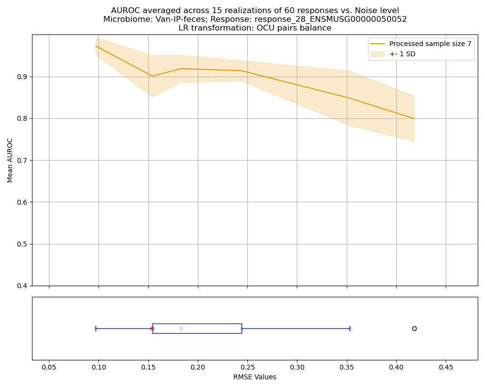

# CompoRes reference

[README](../README.md) · [Synthetic tutorial](tutorial.md)

This reference covers installation, preprocessing and advanced features. Numerical examples and figures come from example runs; your numbers will differ. See the README for statistical interpretation and reproducibility guidance.

## Installation

`CompoRes` runs on Linux (glibc 2.28 or newer, e.g., RHEL/Rocky 8+ or Ubuntu 20.04+) and macOS (Intel and Apple
Silicon). No administrator (root) rights are needed: everything is installed into a conda environment in your home
directory.

1. Clone the repository (if you plan to contribute, fork it first and clone your fork):

```bash
git clone https://github.com/AmirErez/CompoRes.git
cd CompoRes
```

2. Create the environment, with the tested versions of all dependencies, using `conda` or `mamba` (`mamba` is usually
   much faster):

```bash
conda env create --file env/compores_env.yml
# or
mamba env create --file env/compores_env.yml
```

3. Activate the environment:

```bash
conda activate compores_env
# or
mamba activate compores_env
```

4. Install `CompoRes` into the environment, which adds the `compores` command:

```bash
pip install -e .
```

`-e` (editable) links the environment to this folder instead of copying the code, so code changes, e.g., after a
`git pull`, take effect without reinstalling. The `compores` command is available whenever the environment is active.

The full synthetic demo needs the repository's configuration and data files, which are not included in a normal wheel install. Use the editable installation above for `compores --demo`. Help remains available without the demo files.

With dependencies installed, the module entry point can also be run from the repository's `src` folder:

```bash
cd src
python -m compores --help
python -m compores --demo
# For your own data, replace this path with your actual config:
python -m compores --config /path/to/my_config.yaml
```

Both entry points show help with no arguments. Analysis options without `--config` or `--demo` retain the legacy synthetic selection and print a notice; prefer explicit selection in new scripts.

If you created `compores_env` with an earlier version of `env/compores_env.yml`, remove it first
(`conda env remove -n compores_env`) and create it again, to get the tested versions.

#### Uninstalling

```bash
pip uninstall compores              # removes the compores command; the environment stays
conda env remove -n compores_env    # removes the environment and everything installed in it
```

Then delete the `CompoRes` folder.

[Back to README](../README.md)


## COMPUTATIONAL REQUIREMENTS

Below we provide practical examples of computational resources which can be provided to various jobs to run the
`CompoRes` package on datasets of varying sizes. These are empirical observations based on the team's experience in
running the full `CompoRes` pipeline on different datasets: they are indicative only and cannot be considered either
sufficient or necessary conditions for successful execution. Actual resource needs may vary based on specific dataset
characteristics and available computational resources. It is advisable to monitor resource usage and logged outputs
during execution to ensure the package runs smoothly. We highly recommend referring to the [RUNTIME TIPS](#runtime-tips)
section for additional guidance on optimizing run time and resource allocation.

| Dataset Size                                | mem-per-cpu | CPU | `OCU_SAMPLING_RATE` | Shuffles in total |
|---------------------------------------------|-------------|-----|---------------------|-------------------|
| <100 samples, <200 OTUs, <300 responses     | 16GB        | 16  | 15                  | 50                |
| 100-500 samples, ~10000 OTUs, <30 responses | 48GB        | 12  | 200                 | 50                |


[Back to README](../README.md)

## RUNTIME TIPS

1. **Memory Management**
   - Raise `OCU_SAMPLING_RATE` for large datasets with large number of OTUs.
   - Use `--preprocess` flag for initial data exploration.

2. **Signal Significance Estimation**
   - Adjust `SPARCCKIT_MAX_ITER` based on dataset size.
   - Check p-value ranking stabilization across shuffles and adjust number of `SHUFFLE_CYCLES` accordingly.

    
Note: `CompoRes` parallelizes core computations across available CPU cores and processes responses in batches of 100.

[Back to README](../README.md)


## PACKAGE STRUCTURE

### Preprocessing

The `Preprocessor` class handles the preparation of microbiome and response data for the core analysis.
It ensures data consistency by performing quality checks, imputation, and normalization. Then, it generates OTU
clustering outputs. It stores preprocessed data, OCU matrices, and clustering metadata in structured directories.
Below is an overview of the preprocessing flow:

#### Input validation
- Verifies the existence of input files and performs sample indices checks: whether there are duplicated sample IDs
(if so, only the first occurrence is kept when the `--deduplicate` flag is given, otherwise an error is raised)
and retains only sample IDs shared between microbiome and response data, sorting them and logging exclusions.
- Checks for numeric data, non-negative microbiome values, and minimum required dimensions (3 retained samples and 3 taxa for microbiome,
3 retained samples and 1 response variable for response). Negative response values are allowed. Missing response values are replaced with zero, and all-zero response columns are removed; prepare missing measurements deliberately before running.
- Filters microbiome data by removing taxa present in fewer than the `TAXA_FILTER` fraction of samples.

Note: The `pairs` balance method (see [Computational module overview](#computational-module-overview)) is limited to
OCU levels with at most `MAX_OCU` OCUs (800 in the example configuration): levels with more OCUs are skipped for `pairs`,
with a warning in the log, and still processed for `CLR`. Raising the limit may lead to excessive memory consumption and
longer processing times; thus, it is recommended to reduce the number of responses per job, use higher values for
`OCU_SAMPLING_RATE`, and carefully allocate resources when running the package on larger datasets.


#### Imputation process
For samples having missing values for some taxa, the `CompoRes` package uses imputation method similar to that
presented in Palarea-Albaladejo J, Martín-Fernández JA (2015). zCompositions – R package for multivariate imputation of
left-censored data under a compositional approach. Chemometrics and Intelligent Laboratory Systems, 143, 85–96.
doi:10.1016/j.chemolab.2015.02.019; for documentation on `zCompositions` package see:
https://cran.r-project.org/web/packages/zCompositions/zCompositions.pdf.

For the `CompoRes` package, a sample is considered "imputed" in a specific balance if more than 50% of
its taxa content was imputed. For example, for the case of three taxa [`taxon_1`, `taxon_2`, `taxon_3`] and the
following balance data: [`taxon_1`, `taxon_2`] are in numerator and imputed in [`sample_1`, `sample_3`], [`taxon_3`] is
in denominator and imputed in [`sample_2`], `sample_1` and `sample_3` will be considered imputed in the balance and
`sample_2` will not be considered as imputed.

#### Normalization
Normalization ensures that the microbiome abundance data is scaled so that the sum of all values in each row equals one.

#### OTU clustering
The OTU clustering flow includes the following steps:
- Correlation estimation is conducted for the microbiome abundance matrix with a custom implementation of SparCC
algorithm (see [1] Friedman, Alm (2012). Inferring correlation networks from genomic survey data. PLoS Computational
Biology, 8(9), e1002687. https://doi.org/10.1371/journal.pcbi.1002687). The implementation has been optimized to make it
suitable for leveraging the iterative SparCC procedure for larger datasets. The number of SparCC iterations is
dynamically adjusted using an exponential decay function based on the dataset size and the `SPARCCKIT_MAX_ITER`
parameter (see the `config` file example), to manage runtime; this is not a guarantee of optimal performance.
- Correlations between all taxa pairs are converted into a distance matrix, which feeds hierarchical clustering (the
linkage method is set to `average`) to group OTUs into OCUs.
- Clustering cases are sampled with a step defined by OCU_SAMPLING_RATE (see the `config` file example) to dilute
further processing; thus, processed cluster cases start from a total number of given valid OTUs and stop at 3 OCUs.
- For each clustering, a separate abundance matrix is created by summing the values of grouped OTUs and is stored in
microbiome preprocessing results.
- A heatmap of the taxon correlations is plotted, with the taxa ordered, and the dendrogram drawn, by this
hierarchical clustering; for up to 1000 taxa, in `plots/taxa_correlation_clustering`.
- Several clustering metadata artifacts are generated, including a CSV file listing OCU clusters and their OTU
structure (stored as supplementary to highest response-balance correlation plots), as well as two JSON files: one
containing OTU-wise information on imputed samples and one that details fully the overall set of clusters, their OTU
structure, and OCU-wise information on imputed samples (stored in microbiome preprocessing results).

[Back to README](../README.md)

### Computational module overview

#### Applying CoDA methods for association quantification
In the computational module `compores_compute`, CoDA methods are implemented for quantifying associations between
microbiome balances and host response variables across OCU clustering cases. For each OCU clustering and CoDA method,
the module evaluates associations with response features and identifies the balances exhibiting the strongest
correlations for downstream analysis. By default, balances are computed using the CLR transformation of the clustered
microbiome data. Optionally, the SLR (pairwise log-ratio) transformation is computed as well, when `CODA_METHOD` is set
to `pairs` in the configuration file; leave `CODA_METHOD` empty to compute only CLR balances. For
each balance method, p-values of the correlations are estimated (see below).

#### P-value estimation and interpretation

See [Statistical interpretation](../README.md#statistical-interpretation) for the empirical estimator, Fisher transformation, GEV tail estimation, numerical floor, and multiplicity scope. Output names retain `bootstrap` for the empirical permutation estimate.

The code also holds experimental alternatives for observed values beyond the GEV floor, considered during development: refitting the GEV with the observed value added at a predefined weight, either immediately or after sampling from the fitted GEV (the `weight` and `bootstrap` options of `gev_p_value` in `src/compores/utils.py`). They cannot be selected in the configuration file and are not recommended substitutes for empirical permutations; CompoRes floors these p-values at `1e-11`.

#### Outputs
The response ranking, the signal significance plots and the response vs. best balance plots are described, with
examples, in [Walking through the test outputs](tutorial.md#walking-through-the-test-outputs). OTU tracing and the power analysis
are described in [Advanced Features](#advanced-features).

### Used packages

`CompoRes` package draws inspiration from the `R` `SelBal` package for methods to correlate continuous phenotype with
compositional data.

[Back to README](../README.md)

## CONFIGURATION FILE STRUCTURE AND NAMING CONVENTIONS

For creating and using a configuration file, see [Configuration File Usage](../README.md#configuration).

### Naming Conventions

#### MICROBIOME FILE NAMES

Microbiome file names have the following naming convention: `{g1}-{g2}-{g3}.tsv`

##### Where:

`{g1}` - `GROUP1`, first treatment parameter, e.g., substance name;

`{g2}` - `GROUP2`, second treatment parameter, e.g., treatment type;

`{g3}` - `GROUP3`, third treatment parameter, e.g., microbial community composition location.

##### Example:

For an antibiotic treatment...

- with Neomycin...
- delivered through IP...
- and the microbial community sampled from the lumen of the small intestine...

...the microbiome file name would be `./Neo-IP-SI_lumen.tsv`.

#### RESPONSE FILE NAMES

Response file names have the following naming convention: `{g1}-{g2}.tsv`.

##### Where:

`{g1}` - `GROUP1`, first treatment parameter, e.g., substance name;

`{g2}` - `GROUP2`, second treatment parameter, e.g., treatment type;

##### Example:

For an antibiotic treatment...

- with Neomycin...
- delivered through IP...

...the response file name would be `./Neo-IP.tsv`.

#### METADATA FILE NAMES

Metadata file names have the following naming convention: `{g1}-{g2}-metadata.tsv`.

[Back to README](../README.md)

## INPUT FILES FORMATTING

### MICROBIOME FILE APPEARANCE

The microbiome file should be saved as a tab-separated values (`.tsv`) file, with the naming convention mentioned above.

**The file's structure is as follows:**
The first column should contain sample identifiers, every row representing another sample. The file contains abundance
information of respective taxon or group of taxa. Thus, the first row should consist of column titles (taxa
identifiers) separated with a tab; the first column (sample identifiers) needs no title.

### RESPONSE FILE APPEARANCE

The response file should be saved as a tab-separated values (`.tsv`) file, with the naming convention mentioned above.

**The file's structure is as follows:**
The first column should contain sample identifiers, every row representing another sample. The file contains expression
level of the respective gene or group of genes for that sample. Thus, the first row should consist of column titles
(gene or gene groups labels) separated with a tab; the first column (sample identifiers) needs no title.

### METADATA FILE APPEARANCE

The metadata file should be saved as a tab-separated values (`.tsv`) file, with the naming convention mentioned above.

**The file's structure is as follows:**
The first column should contain sample identifiers, every row representing another sample. The second column, titled
`Category`, assigns every sample to one of up to two groups, e.g., `control` and `treated`; the first column needs no
title. The groups are used to color the samples in the response vs. best balance plots.

[Back to README](../README.md)

## ADVANCED FEATURES

### OTU-WISE CUMULATIVE P-VALUE TRACING AND ANALYSIS

After the regular `CompoRes` run, OTU tracing identifies the OTUs that contribute most to each response's association
with the microbiome. For an example on the test data, see [Per-taxon ranking](tutorial.md#5-per-taxon-ranking).

For every response, the p-value of the correlation between the response and every balance is estimated, at every
processed OCU level. Then, the negative log p-values, `-log(p)`, are accumulated for every OTU, with a per-balance
correction for how many OTUs build the OCUs, and normalized by the number of times the OTU was encountered across the
balances. The results are stored in the `otu_significance_tracing` directory, as `-log(p)` scores and as exponentiated scores (historically labelled estimated p-values; not calibrated taxon-level p-values), both for positive and for negative associations with the response:

- For the `CLR` method, every OTU is scored as positively associated if the OCU it belongs to correlates positively with
  the response, and negatively otherwise.
- For the `pairs` method, two types of tracing are performed: 1-D ("condensed") OTU tracing, where an OTU is scored as
  positively associated when it is in the numerator of a pair balance and negatively when it is in the denominator;
  and 2-D OTU-pair tracing, where every OTU pair is scored by its joint appearance in the balances. The 2-D results
  can be further analyzed using cluster analysis methods.

A response can be selected with the `--response` argument (the `response_{index}` prefix is enough, e.g.
`response_1`); without it, all responses are traced.

To run the package on your data and include OTU tracing, execute the following commands in the terminal:

```bash
compores --config {path_to_config_file} --include_otu_trace_analysis
```

Test bash script designed for the SLURM scheduler to perform a test run with OTU tracing:

```bash
#!/bin/bash
#SBATCH --time=24:00:00
#SBATCH -N 1
#SBATCH -c 16
#SBATCH --mem-per-cpu=8G
source "$(conda info --base)/etc/profile.d/conda.sh"
conda activate compores_env
compores --demo --include_otu_trace_analysis
```

[Back to README](../README.md)


### BINARY CLASSIFICATION POWER ANALYSIS PROCESS

You can choose to run a binary classification power analysis after the regular CompoRes package run.
This process is applied to synthetic responses, generated based on the fitted model of balance
and response correlation.


The analysis is performed response-wise. A response tag should be provided via the `--response` argument
(the `response_{index}` prefix is enough, e.g. `response_1`) to specify the response to analyze;
if not provided, the response with the highest resulting correlation ranking is chosen by default. For the provided
response, the RMSE values and fitted regression models are fetched for every OCU case processed during the regular
CompoRes run. For every model / RMSE level, `NUMBER_OF_RESPONSES_TO_GENERATE` (30) synthetic responses of each of two
classes, correlated and uncorrelated, are generated. The classification itself involves re-running the CompoRes package
on the original microbiome and the generated synthetic responses, followed by an analysis of how well the synthetic
responses are classified compared to the class they were generated in. The output is stored in the
`synthetic_power_analysis/{response_tag}` directory.

Classification is performed using a range of p-values derived from the synthetic data. Each synthetic response is
classified as significant (correlated) or not based on its p-value. Since the synthetic responses have known true
labels, this enables the generation of ROC curves and the calculation of the AUC, which indicates the classification
accuracy. High AUC scores signify successful classification. The whole process is repeated
`NUMBER_OF_EXPERIMENT_REPEATS` (15) times; the results are averaged across repeats. Both numbers are constants in
`src/compores/compores_main.py`. These repeated synthetic experiments measure performance under the fitted generation model; they do not establish performance on independent biological data. Ranking-derived or exponentiated aggregate scores remain uncalibrated even when used as classification thresholds. The results, including a box plot showing the noise levels of true responses, are
saved in the same directory as `{g1}-{g2}-{g3}_mean_auroc_vs_noise_pairs_balance_with_noise_analysis.png`:



To run the package on your data and include the power analysis, proceed to execute the following commands in the
terminal:

```bash
compores --config {path_to_config_file} --include_classification_power_analysis
```
OR
```bash
compores --config {path_to_config_file} --include_classification_power_analysis --response response_{i}
```

Test bash script designed for the SLURM scheduler to perform a test run with the power analysis:

```bash
#!/bin/bash
#SBATCH --time=24:00:00
#SBATCH -N 1
#SBATCH -c 16
#SBATCH --mem-per-cpu=8G
source "$(conda info --base)/etc/profile.d/conda.sh"
conda activate compores_env
compores --demo --include_classification_power_analysis
```

[Back to README](../README.md)


### LOGGING

The `compores_main` and `compores_compute` modules have their own log files, which are created
via instances of the `CompoResLogger` class defined in the `logger_module.py` module.

#### Default Log File

A default log instance setup includes the following settings:

- **Log Name**: typically `__name__`,
- **Log File**: `None`,
- **Console Log Level**: `INFO`,
- **Log File Level**: `INFO`,
- **File Mode**: `w` (overwrites the file if it exists).

#### Currently Defined Log Files

Logs are stored in the `logs` subdirectory of the output folder. The following log files are created:

- **`compores_sessions.log`**: Log file for the overall run, e.g., its start, its end and the final response ranking.
- **`{g1}-{g2}-{g3}/compores_main.log`**: Log file for the `compores_main` module, for the experiment.
- **`{g1}-{g2}-{g3}/compores_compute_[number]_OCUs.log`**: Log file for detailed reporting on every OCU clustering.

#### Usage

Log files are created and updated during the execution.
It's recommended not to modify the log files manually.

[Back to README](../README.md)
