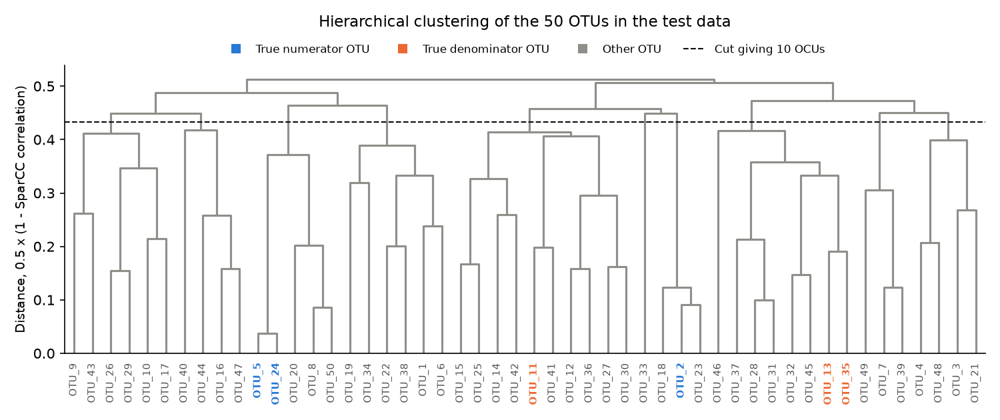
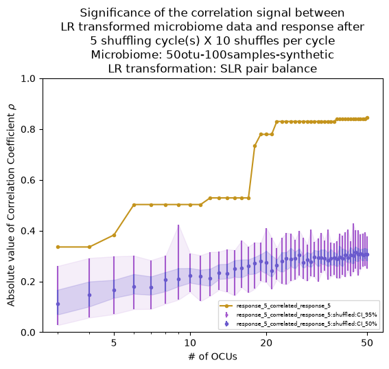
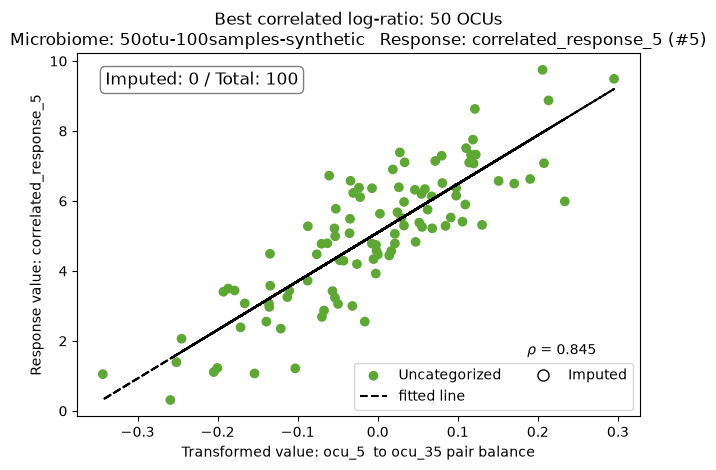
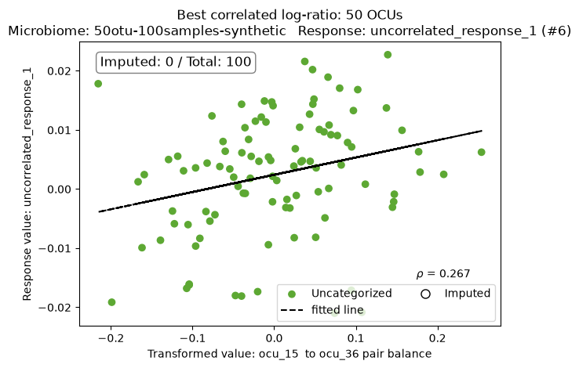

# Synthetic-data tutorial

[README](../README.md) · [Reference](reference.md)

The examples below come from one run of each test; the shuffles are random, so your numbers will differ slightly. Figures are included in `docs/assets/`, alongside these documents, so they also display when a Markdown file is opened directly in VS Code. See the README's [statistical interpretation](../README.md#statistical-interpretation) before interpreting scores. Run the quick configuration command from the repository root; `--demo` works from any folder with the editable installation active.


Two test runs on bundled synthetic data check that the installation works and show what `CompoRes` produces. Start
with the quick test; run the full test when you want the complete picture.

Run the tests from the `CompoRes` folder, with the environment active.

## Quick test

```bash
compores --config configs/config_synthetic_data_quick.yaml
```

## Full test

```bash
compores --demo
```

The full demo selects the bundled configuration, `configs/config_synthetic_data.yaml`. From the repository root, `compores --config configs/config_synthetic_data.yaml` selects the same run. Plain `compores` now shows help. The two tests run the same
analysis on the same data and differ only in how many OCU levels and shuffles they process:

|                                      | Quick test                                  | Full test                                      |
|--------------------------------------|---------------------------------------------|------------------------------------------------|
| Configuration file                   | `configs/config_synthetic_data_quick.yaml`  | `configs/config_synthetic_data.yaml` (selected by `--demo`) |
| OCU levels processed                 | 10 (50, 45, ..., 5; `OCU_SAMPLING_RATE: 5`) | 48 (50, 49, ..., 3; `OCU_SAMPLING_RATE: 1`)    |
| Shuffles per OCU level               | 10 (`N_SHUFFLES: 5` x `SHUFFLE_CYCLES: 2`)  | 50 (`N_SHUFFLES: 10` x `SHUFFLE_CYCLES: 5`)    |
| Run time (18-core Apple Silicon Mac) | about 75 seconds                            | 11 to 13 minutes                               |
| Output folder                        | `artificial_experiment_output_quick`        | `artificial_experiment_output`                 |

The quick test also runs, with its results checked, as part of the automated test suite (`tests/test_quick_test_run.py`),
so pushes and pull requests to `main` that change the code are tested end to end. To run the test suite yourself, run `pytest` from the `CompoRes`
folder; the optional, much slower test of the power analysis runs only with `pytest -m slow`.

Note: `CompoRes` saves its progress and resumes from it, so running a test again with its output folder in place only
re-reports the stored results. Delete the output folder to rerun a test from scratch. The shuffles are random, so the
numbers you get will differ slightly from the examples below.

## What the test does

The synthetic data lives in `tests/data/artificial_experiment_data`:

- Microbiome, `microbiome/50otu-100samples-synthetic.tsv`: relative abundances of 50 OTUs in 100 samples.
- Responses, `response/50otu-100samples.tsv`: 10 responses for the same 100 samples. Five of them were generated from
  a known log-ratio balance of the microbiome; the other five are random noise that does not depend on the microbiome:

| Responses                                               | Numerator OTUs       | Denominator OTUs       | Target correlation |
|---------------------------------------------------------|----------------------|------------------------|--------------------|
| `correlated_response_1` ... `correlated_response_5`     | OTU_2, OTU_5, OTU_24 | OTU_11, OTU_13, OTU_35 | 0.86 - 0.92        |
| `uncorrelated_response_1` ... `uncorrelated_response_5` | none (noise)         | none (noise)           | 0                  |

### From OTUs to OCUs

Many OTUs rise and fall together across samples, and a response may be linked to such a group rather than to a single
OTU. `CompoRes` therefore groups correlated OTUs into OCUs: an OCU is a cluster of OTUs whose abundance in each sample
is the sum of its OTUs' abundances. Rather than committing to one grouping, `CompoRes` repeats the whole analysis at
many levels of grouping, from one OTU per OCU down to a few large OCUs. Persistence across levels can support interpretation, but chance signals can also persist because levels are dependent; it is not a global significance test.

The OCUs are obtained in three steps (for details, see [OTU clustering](reference.md#otu-clustering)):

1. SparCC estimates the correlation between every pair of OTUs, taking into account that the data is compositional.
2. The correlations are turned into distances, 0.5 x (1 - correlation), and the OTUs are clustered hierarchically
   (average linkage) into a tree, or dendrogram.
3. Cutting the tree at different heights gives the OCU levels: low cuts give many small OCUs, high cuts give a few
   large ones. `OCU_SAMPLING_RATE` sets how many levels are processed: every level in the full test (50, 49, ..., 3
   OCUs) and every 5th level in the quick test (50, 45, ..., 5 OCUs).

The tree below is drawn from the quick test's SparCC correlations with the same distance and linkage as `CompoRes`.
The dashed line is the cut that gives 10 OCUs: every branch it crosses is one OCU. `CompoRes` draws the same tree, with
a heatmap of the correlations ordered by it, in
`plots/taxa_correlation_clustering/50otu-100samples-synthetic/50otu-100samples-synthetic_taxa_correlation_clustered_heatmap.png`;
it is also in the "Taxon clustering" section of `report.html`.



OTU_5 and OTU_24, two of the true numerator OTUs, are the most correlated pair and join first, so they share an OCU at
every level below 50 OCUs. At 10 OCUs, for example, the true OTUs sit in these OCUs:

| OCU at the 10-OCU level | OTUs                                                                     |
|-------------------------|--------------------------------------------------------------------------|
| `ocu_3`                 | **OTU_5**, OTU_8, OTU_20, **OTU_24**, OTU_50                             |
| `ocu_6`                 | **OTU_2**, OTU_18, OTU_23                                                |
| `ocu_8`                 | **OTU_13**, OTU_28, OTU_31, OTU_32, **OTU_35**, OTU_37, OTU_45, OTU_46   |
| `ocu_5`                 | **OTU_11**, OTU_12, OTU_14, OTU_15, OTU_25, OTU_27, OTU_30, OTU_36, OTU_41, OTU_42 |

The OCU membership of every level is listed in an `..._OCU_taxa_mapping.csv` file in every
`plots/response_vs_best_balance/50otu-100samples-synthetic/{method}/{level}/` folder, and in
`preprocessing_results/microbiome/OCUs/50otu-100samples-synthetic/50otu-100samples-synthetic_ocu_clustering_dictionary.json`.
The OCU abundance matrix of every level is in the `{level}/` folders next to that file.

### The analysis

The test runs the whole `CompoRes` pipeline on this data:

1. **Preprocessing:** checks the input files, filters rare taxa, imputes zeros (this data has none) and normalizes each
   sample to sum to one.
2. **OTU clustering:** groups the OTUs into OCUs at every processed level, as described above.
3. **Best balance search:** at every OCU level and for every response, finds the log-ratio balance with the highest
   absolute correlation to the response (Pearson correlation, as set by `CORR`). This is done twice: with `CLR` balances (one OCU against the geometric
   mean of all OCUs) and with `pairs` balances (the log-ratio of two OCUs).
4. **Significance:** shuffles the microbiome samples (as set by `SHUFFLE`) and repeats the best balance search on the shuffled data, many
   times. This gives the distribution of the best correlation expected by chance, from which p-values are estimated in
   two ways: empirically (the output calls this `bootstrap`, but it is a permutation estimate) and by fitting a GEV distribution.
5. **Ranking:** ranks the responses by their -ln(p) averaged over all processed OCU levels.

The test is expected to rank the five correlated responses above the noise responses and to find best balances built
from the true OTUs. The automated quick test checks that the five correlated responses rank on top for both `CLR` and
`pairs`, and that the best `pairs` balance of `correlated_response_5` at 50 OCUs is OTU_5 over OTU_35. Exact scores and
OCU membership vary between runs.

## Walking through the test outputs

All outputs are written to the test's output folder; its layout is described in [Output Overview](../README.md#output-navigation).
The quickest way to explore them is `report.html` in that folder: open it in a browser for the response ranking, and
click a response for its plots and best balances. The parts below walk through the same results file by file.
The examples below come from the quick test, with the `pairs` balance method unless noted otherwise; every output also
exists for `CLR`.

### 1. Response ranking

The response ranking answers which responses are linked to the microbiome. It is in
`compores_response_ranking/50otu-100samples-synthetic/pairs/minus_mean_log_p_value_sorted_responses_at_shuffling_cycle_2.csv`
(one file is written per shuffling cycle; this is the last one):

| Response                              | gev   | bootstrap |
|---------------------------------------|-------|-----------|
| `response_5_correlated_response_5`    | 24.62 | 2.40      |
| `response_2_correlated_response_2`    | 21.31 | 2.40      |
| `response_3_correlated_response_3`    | 20.50 | 2.40      |
| `response_1_correlated_response_1`    | 20.24 | 2.40      |
| `response_4_correlated_response_4`    | 19.53 | 2.40      |
| `response_8_uncorrelated_response_3`  | 4.28  | 1.72      |
| `response_10_uncorrelated_response_5` | 0.50  | 0.55      |
| `response_7_uncorrelated_response_2`  | 0.17  | 0.17      |
| `response_9_uncorrelated_response_4`  | 0.09  | 0.07      |
| `response_6_uncorrelated_response_1`  | 0.09  | 0.08      |

Each value is the response's -ln(p) averaged over the processed OCU levels, where p is the p-value of the response's
best balance at that level; higher means a stronger ranking score, not a calibrated global significance level. For example, the best balance of `correlated_response_5` hit
the GEV floor of p = 1e-11 (-ln(p) = 25.33) at 9 of the 10 levels and had p = 1.2e-8 (-ln(p) = 18.23) at 35 OCUs (see
part 4 below), so its score is (9 x 25.33 + 18.23) / 10 = 24.62.

All five correlated responses rank on top, with a clear gap to the noise responses. A noise response can still score a
few units by chance, as `uncorrelated_response_3` does here, so neither a gap nor a single score establishes a controlled error rate.
The `CLR` ranking (in the `CLR` folder) agrees: the five correlated responses score between 12.4 and 21.6 and the noise
responses at most 6.5. In general, responses that rank high for both balance methods and both p-value columns are useful candidates for follow-up; agreement does not itself provide an error-rate guarantee. More shuffling cycles can improve ranking stability; responses with very small p-values may still swap places
between cycles.

The two columns show why `CompoRes` fits a GEV distribution. With 10 shuffles the smallest possible empirical p-value
is 1/11, so the bootstrap column cannot go above ln(11) = 2.40, and all correlated responses tie there (in the full test,
with 50 shuffles, the ceiling is ln(51) = 3.93). The GEV fit extrapolates the tail and can separate tied empirical scores, but ten shuffled maxima provide very limited evidence for extreme-tail calibration; its p-values are floored at 1e-11, so the GEV column cannot go above -ln(1e-11) = 25.3.

### 2. Signal significance plots

`plots/compores_signal_significance/50otu-100samples-synthetic/pairs/` holds one plot per response. The orange line is
the absolute correlation of the best balance at every OCU level; in purple is the best correlation found in shuffled
data (dots: median, dark band: 25th to 75th percentile, light band and whiskers: 2.5th to 97.5th percentile).


For `correlated_response_5` (left), the real correlation is far above the shuffled bands at every OCU level. It is
strongest, about 0.84, from 25 to 50 OCUs, and drops at coarser clustering, as the true OTUs get merged with unrelated
OTUs. For `uncorrelated_response_1` (right), the real correlation stays inside or below the shuffled bands.

The shuffled bands rise with the number of OCUs: more OCUs means more candidate balances, so the best one correlates
better by chance alone. Repeating the best-balance search in each shuffle accounts for selection among candidate balances within that response, method and OCU level; it does not establish correction across responses or levels.

The full test produces the same plot with all 48 OCU levels and 50 shuffles, which shows the step-like changes in the
signal as true OTUs split into their own OCUs:



### 3. Response vs. best balance plots

`plots/response_vs_best_balance/50otu-100samples-synthetic/pairs/{OCU level}/` holds, for every response, a scatter
plot of the response against its best balance at that OCU level, with the fitted line. The box in the corner counts the
samples with imputed values (none in this data). Samples are colored by their group in the metadata file; the quick test
has no metadata, so all samples are "Uncategorized".




At 50 OCUs, the best balance for `correlated_response_5` (left) is `ocu_5` over `ocu_35`, with a correlation of 0.845.
At this level every OCU is a single OTU (`ocu_5` is OTU_5 and `ocu_35` is OTU_35), so the balance pairs one OTU from
each side of the true balance. The best balance for `uncorrelated_response_1` (right) reaches only 0.27, a correlation
that the shuffled data matches by chance (see the plot above).

### 4. Best balance at every OCU level

`balance_calculation_results/50otu-100samples-synthetic/pairs/ocu_level_results/regular/` has one table per response
with the best balance at every OCU level, its correlation (`rho`), the fitted line (`slope`, `intercept`, `rmse`),
percentiles of the shuffled correlations, and both p-values. For `correlated_response_5` (OTUs from the true balance in
bold):

| OCU level | Numerator OTUs                                | Denominator OTUs                                                       | rho  | Shuffled median rho | p (GEV) |
|-----------|-----------------------------------------------|------------------------------------------------------------------------|------|---------------------|---------|
| 50        | **OTU_5**                                     | **OTU_35**                                                             | 0.84 | 0.30                | 1e-11   |
| 45        | **OTU_5**, **OTU_24**                         | **OTU_35**                                                             | 0.84 | 0.31                | 1e-11   |
| 35        | **OTU_5**, **OTU_24**                         | **OTU_13**, **OTU_35**                                                 | 0.83 | 0.26                | 1.2e-8  |
| 20        | **OTU_5**, **OTU_24**                         | **OTU_13**, OTU_32, **OTU_35**, OTU_45                                 | 0.78 | 0.29                | 1e-11   |
| 10        | **OTU_5**, OTU_8, OTU_20, **OTU_24**, OTU_50  | **OTU_13**, OTU_28, OTU_31, OTU_32, **OTU_35**, OTU_37, OTU_45, OTU_46 | 0.50 | 0.25                | 1e-11   |
| 5         | 14 OTUs, including **OTU_2** and **OTU_11**   | 8 OTUs, including **OTU_13** and **OTU_35**                            | 0.38 | 0.18                | 1e-11   |

As the clustering gets coarser, the true OTUs are merged with unrelated OTUs and the correlation drops. At 5 OCUs the
numerator even mixes OTU_2 from the true numerator with OTU_11 from the true denominator. Still, the correlation stays
well above the shuffled median at every level.

The `sample_level_results` folder next to it has, for every response and OCU level, the balance value and response value
of every sample.

### 5. Per-taxon ranking

The response ranking says which responses are linked to the microbiome; OTU tracing says which OTUs carry the link,
response by response. It runs on demand, after the main analysis:

```bash
compores --config configs/config_synthetic_data_quick.yaml --include_otu_trace_analysis
```

If the test has already run, this only adds the tracing (about 3.5 minutes for the 10 test responses). Without
`--response`, every response is traced; add, e.g., `--response response_5` to trace one response.

For `CLR`, every OTU gets two scores per response: one for a positive and one for a negative association. At every OCU
level, the -ln(p) of each OCU's correlation with the response is split equally among the OTUs in that OCU and added to
their positive or negative score, according to the sign of the correlation. Each score is then divided by the number
of levels that added to it, which makes it an average over OCU levels. An OTU scores high when its containing OCUs accumulate large association scores; this is not a calibrated taxon-level significance test.

The scores are in
`otu_significance_tracing/50otu-100samples-synthetic/CLR/50otu-100samples-synthetic_otu_clr_minus_mean_log_p_values_{response}.tsv`,
one file per response, with one row per OTU and the columns `minus_mean_log_p_value_positive` and
`minus_mean_log_p_value_negative`; sort by either column to rank the OTUs. Next to it, `..._estimated_p_value_...`
files hold exponentiated scores, exp(-score), which are not calibrated taxon-level p-values, and `..._normalization_count_...` files hold the number of OCU
levels each score is averaged over. The top three OTUs in each direction, for every test response (true OTUs in bold):

| Response                  | Top positive OTUs (score)                        | Top negative OTUs (score)                            |
|---------------------------|--------------------------------------------------|------------------------------------------------------|
| `correlated_response_1`   | **OTU_5** (5.3), **OTU_24** (5.2), OTU_22 (2.6)  | **OTU_35** (6.4), **OTU_11** (6.0), **OTU_13** (5.0) |
| `correlated_response_2`   | **OTU_24** (7.6), **OTU_5** (7.6), OTU_22 (5.3)  | **OTU_35** (8.1), **OTU_13** (7.7), **OTU_11** (7.7) |
| `correlated_response_3`   | **OTU_5** (9.3), **OTU_24** (9.3), OTU_22 (6.2)  | **OTU_35** (11.8), **OTU_13** (11.8), **OTU_11** (11.2) |
| `correlated_response_4`   | **OTU_5** (7.8), **OTU_24** (7.7), OTU_22 (3.0)  | **OTU_35** (8.2), **OTU_13** (7.0), OTU_32 (4.6)     |
| `correlated_response_5`   | **OTU_24** (9.1), **OTU_5** (9.1), OTU_22 (6.9)  | **OTU_11** (12.0), **OTU_35** (9.9), **OTU_13** (9.8) |
| `uncorrelated_response_1` | OTU_40 (0.1), OTU_15 (0.0), OTU_47 (0.0)         | OTU_36 (0.0), OTU_33 (0.0), OTU_46 (0.0)             |
| `uncorrelated_response_2` | OTU_33 (0.0), OTU_25 (0.0), OTU_42 (0.0)         | OTU_40 (0.1), OTU_3 (0.0), OTU_21 (0.0)              |
| `uncorrelated_response_3` | OTU_48 (3.4), OTU_4 (0.3), OTU_46 (0.0)          | OTU_41 (0.6), OTU_15 (0.6), OTU_11 (0.4)             |
| `uncorrelated_response_4` | OTU_20 (0.0), OTU_22 (0.0), OTU_38 (0.0)         | OTU_33 (0.0), OTU_4 (0.0), OTU_48 (0.0)              |
| `uncorrelated_response_5` | OTU_10 (0.7), OTU_33 (0.1), OTU_4 (0.0)          | OTU_33 (0.0), OTU_23 (0.0), OTU_2 (0.0)              |

For every correlated response, OTU_5 and OTU_24 lead the positive side and the true denominator OTUs lead the negative
side (all three of them for four of the five responses). Two imperfections are worth knowing: OTU_22, which is not in
the true balance, comes third on the positive side, and OTU_2, the third true numerator OTU, ranks lower (6th for
`correlated_response_5`). The noise responses score close to zero for every OTU, apart from OTU_48 for
`uncorrelated_response_3`, the same noise response that scored highest in the response ranking.

The `pairs` folder has per-OTU scores too, in the `..._otu_pairs_condensed_minus_mean_log_p_values_...` files: an OTU
scores positively when it is in the numerator of a pair balance contributing association evidence and negatively when it is in the
denominator. They give the same top two OTUs on each side for all five correlated responses: OTU_5 and OTU_24, and
OTU_35 and OTU_13. The `..._otu_pairs_minus_mean_log_p_values_...` files without `condensed` hold an OTU-by-OTU matrix
that scores every numerator-denominator OTU pair.

[Back to README](../README.md)

